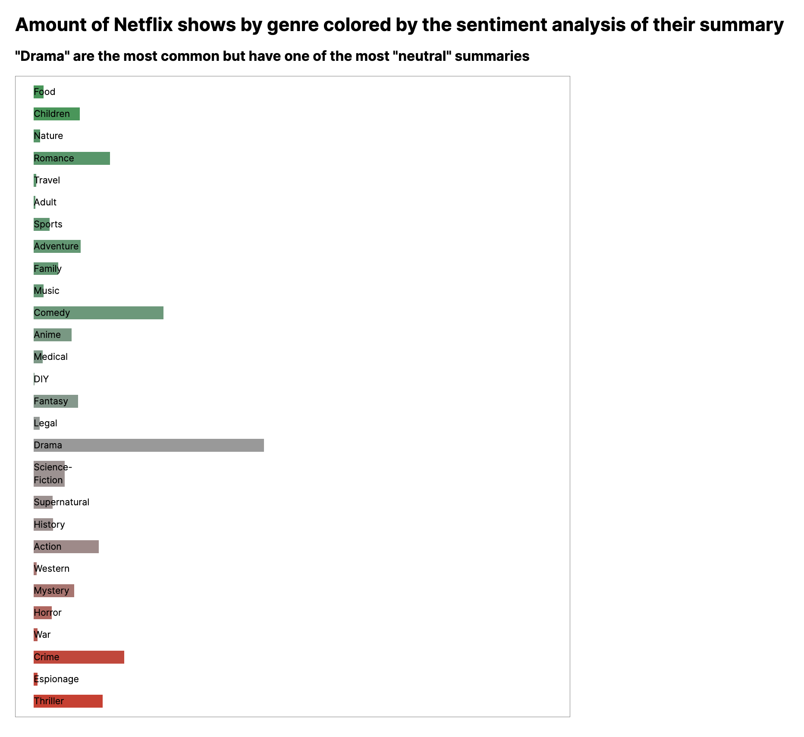

# Sentiment analysis using wink-sentiment

The analyzed text is the summaries of shows on Netflix. The analysis was carried out by separating all the genres on the list using split(','). Then, the shows were mapped using d3.rollup and transformed into an array. For each genre, an object was created with the name of the genre and the average sentiment rating (using winkSentiment and d3.mean). The color scale gives a red color to the lowest average, green to the highest and grey is used for the "neutral" sentiment (0). The length of the bar is the amount of shows with that genre.